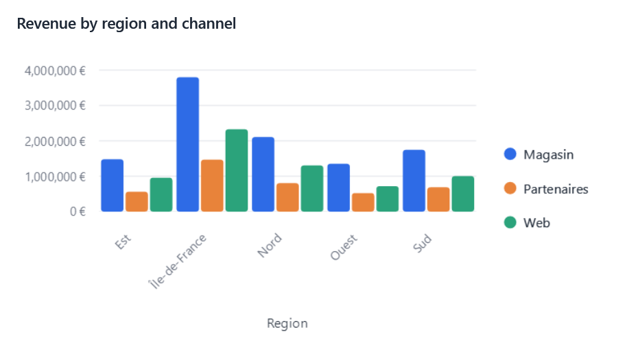
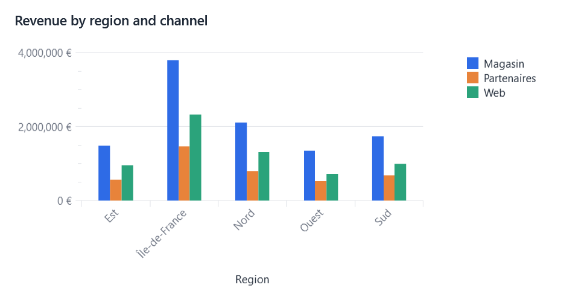

# Writing a connector

A connector draws EasyBI's visuals with a charting library. EasyBI comes with two, which draw the same visual their own
way:

<div class="grid" markdown>





</div>

| EasyBI does | The connector does |
|---|---|
| Queries, pivots, sorts, applies filters and time calculations | Draws `request.Chart` with its library |
| Picks the renderer for each visual | Declares the types it draws |
| Builds tooltips, legends' pages, colors of conditional formats | Shows them, from `request` |
| Turns clicks into cross-filtering | Reports clicks with `request.Select` |

A connector implements a single interface. It receives **already queried and pivoted** data
(`request.Chart`: categories + series) and the raw `ResultSet` if needed:

```csharp
public sealed class MyRenderer : IVisualRenderer
{
    public string Name => "MyLib";
    public RendererCapabilities Capabilities { get; } = new(new HashSet<VisualType> { VisualType.Bar });
    public FrameworkElement Render(RenderRequest request) { /* request.Chart.Categories, request.Chart.Series */ }
}
```

A connector can also draw a type of its own, which it declares in `Capabilities.VisualTypes`: see
[Custom visual types](visual-types.md).

Each `ChartSeries` comes with its resolved `SeriesType` and `SecondaryAxis`: a connector draws every series with its own
type, so one chart can mix bars, lines, areas and points.

Colors come from `request.Theme`: series take `ColorAt(index)`, text `Foreground`, axis labels `MutedForeground`, grid
lines `GridLine`, tooltips `Background` (each one null when the theme does not set it: keep the library's default).
Draw on a transparent background, so that the chart sits on the theme's surface.

**Tooltips** are EasyBI's: a connector replaces its library's tooltip (or tracker) with a `ChartTooltipHost`
(EasyBI.Wpf), and shows in it, while the pointer moves over the chart, the content of the hovered category and series:

```csharp
var tooltip = new ChartTooltipHost(view);
view.MouseMove += (_, e) => tooltip.Show(HitTest(e.GetPosition(view)) is { } hit
    ? request.TooltipFor(hit.Category, [hit.Series])   // EasyBI.Core: the visual's settings and the application's changes
    : null);                                           // null hides it
```

**Legends** follow `ChartFitting` (EasyBI.Core), which gives the place of the legend and its pages for the chart's size,
the visual's choice (`request.Visual.LegendPosition`) and the size of the library's entries (`LegendMetrics`). The host
turns the pages through `request.LegendPager`: a connector shows the entries of its page and fits again when it changes.

```csharp
void Fit()
{
    var fit = ChartFitting.Cartesian(request.Chart, view.ActualWidth, view.ActualHeight, request.Visual.LegendPosition, MyMetrics);
    var shown = ChartFitting.LegendEntries(fit, request.LegendPager);   // also tells the pager where the legend is
    for (var i = 0; i < series.Count; i++) series[i].ShowInLegend = shown(i);
}
view.SizeChanged += (_, _) => Fit();
if (request.LegendPager is { } pager) pager.Changed += (_, _) => Fit();
```

`EasyBIContext.ResolveRenderer` negotiates capabilities: the active renderer if it supports every type the
visual uses (the visual's and its measures'), otherwise another plugged-in renderer, otherwise a built-in one. The designer disables
the types that no renderer can draw.

## Renderer options

A connector offers settings of its own to the end user by declaring them in its capabilities: the designer shows them
in the "Options" section of its properties panel (`DesignerPropertySections.Options`) for the visuals they apply to, as
a check box, a list or a number box, and saves their values with the visual.

```csharp
public RendererCapabilities Capabilities { get; } = new(marks)
{
    Options =
    [
        RendererOption.Toggle("scrollable", () => Strings.Scrollable, appliesTo: v => v.Type.IsCartesian()),
        RendererOption.Choice("curve", () => Strings.Curve, [new("straight", () => Strings.Straight), new("smooth", () => Strings.Smooth)]),
        RendererOption.Number("barWidth", () => Strings.BarWidth, 48, minimum: 4, maximum: 120),
    ],
};

public FrameworkElement Render(RenderRequest request)
{
    var scrollable = request.Visual.GetRendererOption<bool>(Name, "scrollable");   // EasyBI.Core
    ...
}
```

- Labels are functions, read when shown, so that they follow the EasyBI language (`EasyBILocalization.UICulture`).
- Values are stored in `VisualDefinition.Extensions`, one JSON object per renderer under its name
  (`"LiveCharts2": "{\"scrollable\":true}"`); a value equal to the option's default is not stored. The settings of a
  renderer are kept while another one draws the visual. `WithRendererOption` sets one in code.
- The LiveCharts2 connector offers **Scroll bar** (`LiveCharts2Renderer.ScrollableOption`) on cartesian charts: the chart
  shows the first 20 categories (`ScrollWindow`) above a small chart of all of them, where a band marks the visible
  ones; dragging on it scrolls, the mouse wheel on the chart zooms.
