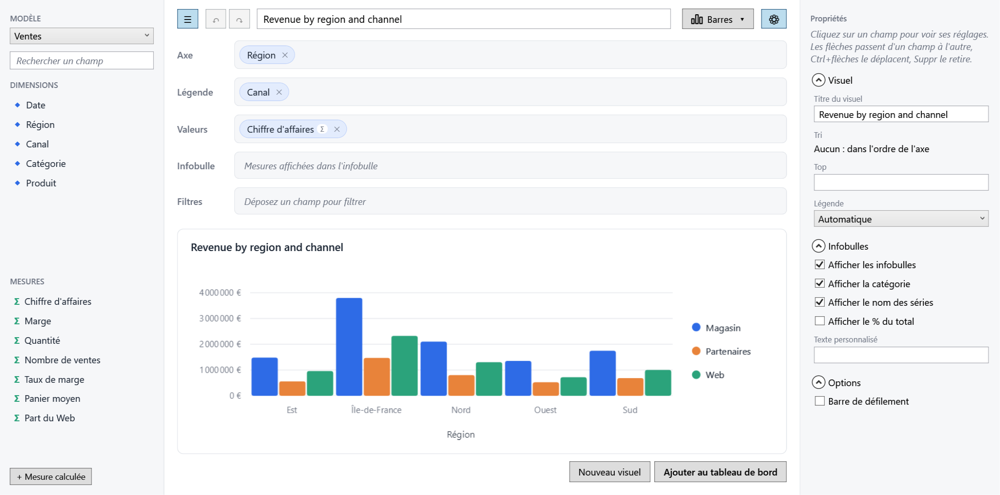

# Localization

EasyBI's own texts (designer, filter bar, messages, granularity and aggregation names, blank and
boolean values) ship in **English** and **French**. The language can change at runtime: designer,
filter bar and visuals update immediately.



```csharp
EasyBILocalization.Culture = CultureInfo.GetCultureInfo("fr-FR"); // null = follow CurrentUICulture
```

The same culture formats numbers and dates. Your semantic model captions can follow the language too:
call `Localize` with your own resources, and every caption becomes a resource key (a missing key falls
back to the caption itself).

```csharp
var model = SemanticModel.For(db.Sales, "sales", "Sales")
    .Dimension(s => s.Region, "Region")
    .Measure(s => s.Amount, "Revenue")
    .Localize(MyStrings.ResourceManager);
```

Your own XAML texts can follow it as well with `LocalizedStrings` and the `Localize` markup extension:

```csharp
public static LocalizedStrings Texts { get; } = new(MyStrings.ResourceManager);
```

```xml
<Button Content="{bi:Localize Save, Source={x:Static local:App.Texts}}" />
```

Visual and report titles are user content: they are stored as typed and not translated.
