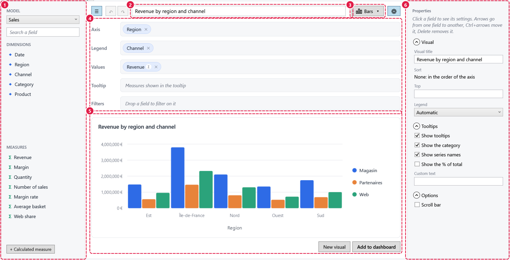

# Customizing the components: slots

The parts of the `ReportDesigner`, `FieldList`, `FilterBar`, `FilterEditor` and `DashboardView` are **slots**: named places
where an application adds its own content (before or after the default content), replaces it, or hides it.



```xml
<bi:ReportDesigner Context="{Binding Context}">
    <bi:Slots.Items>
        <!-- Under the preview -->
        <bi:Slot Name="{x:Static bi:ReportDesignerSlots.Preview}">
            <Button Content="Publish" Command="{Binding DataContext.PublishCommand, RelativeSource={RelativeSource AncestorType=Window}}" />
        </bi:Slot>
        <bi:Slot Name="{x:Static bi:ReportDesignerSlots.Title}" Mode="Before"><TextBlock Text="Title:" /></bi:Slot>
        <bi:Slot Name="{x:Static bi:ReportDesignerSlots.FiltersShelf}" Mode="Hide" />
    </bi:Slots.Items>
</bi:ReportDesigner>
```

```csharp
Slots.Add(designer, ReportDesignerSlots.Header, exportButton);              // after the default content
Slots.Add(designer, ReportDesignerSlots.Fields, help, SlotMode.Before);      // above the field list
Slots.Add(filterBar, FilterBarSlots.AddButton, myAddButton, SlotMode.Replace);
Slots.Hide(designer, ReportDesignerSlots.FieldPanel);
```

## Modes

| `SlotMode` | Your content goes |
|---|---|
| `After` (default) | After the default content: on its right, or below it in a vertical slot (`Fields`, `Shelves`, `Preview`) |
| `Before` | Before it: on its left, or above it |
| `Replace` | Instead of it |
| `Hide` | Nowhere: the part disappears |

Several slots with the same name show in declaration order; the last `Replace` or `Hide` wins.

## Names

| Component | `...Slots` |
|---|---|
| `ReportDesigner` | `FieldPanel`, `Fields`, `Header` (with `Title`, `VisualTypes`), `Shelves` (with `AxisShelf`, `LegendShelf`, `ValuesShelf`, `TooltipShelf`, `FiltersShelf`), `Preview`, `Properties` |
| `FieldList` | `Model`, `Search`, `Dimensions`, `Measures`, `AddMeasureButton` |
| `FilterBar` | `Filters`, `Label`, `Slicer`, `AddButton`, `Selection` |
| `FilterEditor` | `Values`, `Period` |
| `DashboardView` | `Body`, `ItemContent`, `EmptyItemChoices`, `ItemToolbar` |

The band menu of a dashboard is a menu, not a slot: change it in `BandMenuBehavior.MenuOpening`.

## Data context

Your content takes the data context of the place it shows in:

| Where | Data context |
|---|---|
| The designer | Its `DesignerViewModel` (`{Binding Visual.Title}`...) |
| The filter bar, the field list | The application's |
| `FilterBarSlots.Slicer` | The `SlicerViewModel` of a global filter |
| The filter editor | The `FilterItemViewModel` |
| The dashboard item slots | The `DashboardItem` (`DashboardCommands` act on it) |

To reach your window's view-model from the designer: `{Binding DataContext.MyCommand, RelativeSource={RelativeSource AncestorType=Window}}`.

## Repeated slots take a template

An element can only be shown once. A slot shown several times (`FilterBarSlots.Slicer` once per global filter, the
dashboard item slots once per item, slots declared for several components) takes a `ContentTemplate`, applied to the
data context of each place:

```csharp
Slots.AddTemplate(dashboard, DashboardSlots.ItemToolbar, (DataTemplate)FindResource("ExportButton"));
```

## Inheritance

`Slots.Items` is inherited: slots declared on a window or a panel apply to every component in it, and the nearest
declaration replaces the others. The designer opened to edit a dashboard visual takes the slots of the dashboard.

## Your own templates

The components are lookless controls. Their default templates (`Themes/*.xaml` of `EasyBI.Wpf`) are built from
`SlotHost`s (`<bi:SlotHost Slot="..." Orientation="Vertical">` with the default content inside), so a template of
yours keeps the slots it hosts. A template works with the components' read-only properties and commands:

| Component | For templates |
|---|---|
| `ReportDesigner` | Its `ViewModel` (`DesignerViewModel`), the template's data context |
| `FieldList` | `ModelOptions`, `Dimensions`, `Measures`, `CanAddMeasure`, `AddMeasureCommand`, `EditMeasureCommand`, `DeleteMeasureCommand`, `ResetMeasureCommand` (with `ModelField.IsEditable`, `IsReportMeasure`, `IsRedefined`) |
| `FilterBar` | `Slicers`, `SelectionDescription`, `AddFilterCommand`, `RemoveFilterCommand` (on the slicer of its data context), `ClearSelectionCommand` |
| `DashboardView` | `Panel`, `DashboardCommands` |
