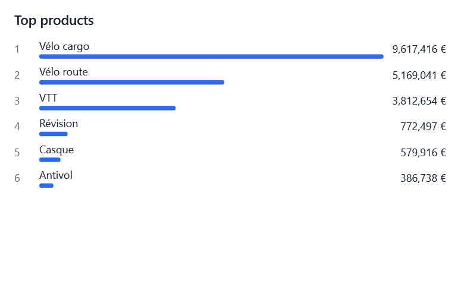

# Custom visual types

{ width="460" }

A visual type is a `VisualType` (an id) and its `VisualTypeDefinition`: its name, its section of the designer's gallery,
the fields each well takes, its tooltips, its settings and its rules. EasyBI's own types (`VisualType.Bar`,
`VisualType.Pie`...) are defined the same way, in the context's catalog (`EasyBIContext.VisualTypes`), so a type of the
application goes through the same paths: the gallery, the wells, the properties panel, the validation, the fields
dropped on a dashboard, cross-filtering and tooltips.

## Declaring a type

```csharp
public static class BusinessTypes
{
    public static readonly VisualType Treemap = new("barista.treemap");

    public static VisualTypeDefinition TreemapDefinition { get; } = new(Treemap, () => Texts.Treemap)
    {
        Group = VisualTypeGroup.Composition,                          // section of the gallery; null: not offered
        Axis = new() { MinFields = 1, MaxFields = 2, Caption = () => Texts.Groups },
        Legend = VisualWell.Unused,
        Values = new() { MinFields = 1, MaxFields = 1, Caption = () => Texts.Size },
        HasTooltips = true,                                           // the tooltip well, and its measures queried
        Format = FormatTarget.Chart,                                  // the format settings of its values
        Options = [RendererOption.Toggle("labels", () => Texts.ShowLabels, @default: true)],
        Validate = v => v.Top is > 50 ? Texts.TooManyRectangles : null,
    };
}

var context = EasyBIContext.Create()
    .AddModel(sales)
    .AddVisualType(BusinessTypes.TreemapDefinition)
    .UseRenderer(new LiveCharts2Renderer())
    .UseRenderer(new TreemapRenderer());
```

- **The id has a prefix** (`barista.treemap`), so that it never takes the name of a type EasyBI adds later:
  `AddVisualType` refuses an id without one. The id is what the report saves (`"type": "barista.treemap"`): keep it
  stable.
- **Captions** are functions, read each time, so that they follow the language of EasyBI (see
  [Localization](localization.md)).
- **Wells**: `IsUsed` (a well the type does not use refuses fields), `MinFields`, `MaxFields` (null: no limit) and the
  name the designer gives the well (null: Axis, Legend or Values). The designer refuses a field beyond `MaxFields`, and
  the visual tells what is missing or too much. By default a type takes up to three axis fields, one legend and at least
  one measure.
- **`Validate`** is a rule of the type, checked before the wells, so that its message, more precise, comes first.
- **`Options`** are settings of the type, shown in the *Options* section of the properties panel whatever the renderer
  drawing it, and saved in the visual's `Extensions` under the type's id. The renderer reads them with
  `visual.GetTypeOption<bool>("labels", true)`.

## Drawing it

A renderer draws the type when its capabilities list it, like any type (see [Writing a connector](connectors.md)). It
receives the usual `RenderRequest`: the query result (`Result`) and the pivoted data (`Chart`: one category per axis
value, one series per measure and legend value). It reports clicks with `request.Select(new CategorySelection(...))`,
which cross-filters the other visuals, and shows tooltips with `request.TooltipFor(category, series)`.

```csharp
public sealed class TreemapRenderer : IVisualRenderer
{
    public string Name => "Treemap";

    public RendererCapabilities Capabilities { get; } = new(new HashSet<VisualType> { BusinessTypes.Treemap })
    {
        // Optional: declared with the renderer, so that plugging it in is enough
        VisualTypes = [BusinessTypes.TreemapDefinition],
    };

    public FrameworkElement Render(RenderRequest request) => new TreemapView(request);
}
```

When the renderer lists the definition in `VisualTypes`, `UseRenderer` declares the type, unless the catalog already
has it: a library of visuals is plugged in with one call. The sample application's `RankingRenderer` is a complete
example: a ranking of a dimension's items by a measure, with a setting, its icon, cross-filtering and tooltips. Without a renderer for it, the type is greyed in the gallery,
and its visuals say that no renderer draws them.

## Its icon

The gallery shows the icon of a type from the resources: a `Geometry` drawn with the foreground in a 16×16 box, under
the key of the type. Without one, the type shows a default icon. The same key replaces the icon of one of EasyBI's
types.

```xml
<Application.Resources>
    <Geometry x:Key="{bi:VisualTypeIconKey barista.treemap}">M1.5,1.5 H9 V14.5 H1.5 Z M10,1.5 H14.5 V8 H10 Z M10,9 H14.5 V14.5 H10 Z</Geometry>
    <Geometry x:Key="{bi:VisualTypeIconKey Bar}">M2,14 V6 M6,14 V2 M10,14 V8 M14,14 V4</Geometry>
</Application.Resources>
```

In code, the key is `VisualTypeIcons.KeyOf(type)`.

## Changing EasyBI's types

The catalog of the context changes EasyBI's types too, before the designer shows:

```csharp
var types = context.VisualTypes;
types.Hide(VisualType.Waterfall);                                     // out of the gallery; its visuals still show
types.Replace(types.Get(VisualType.Bar) with { Caption = () => Texts.Columns });
```

??? example "Keep only a few types"
    Hide every other type of the gallery, after the renderers are plugged in (a renderer may bring types of its own):

    ```csharp
    VisualType[] kept = [VisualType.Bar, VisualType.Line, VisualType.Pie];
    foreach (var type in context.VisualTypes.Definitions
                 .Where(d => d.Group is not null && !kept.Contains(d.Type))
                 .Select(d => d.Type).ToList())   // Hide changes the catalog being read
        context.VisualTypes.Hide(type);
    ```

    For a single designer, a [rule](../guide/designer/rules.md) greys the other types instead.

A report written by another application can hold a type this one does not declare: it opens, and the visual says
that no renderer draws it.

## What a type cannot do yet

- Have other wells than Axis, Legend and Values (a size and a color, for instance).
- Show its own content without querying a model, like the text and image visuals.
- Get its data in another shape than the result and the pivoted chart data: a renderer needing another shape builds it
  from `request.Result`.
