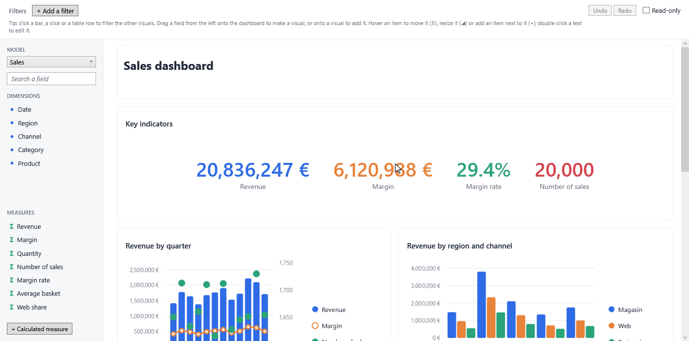
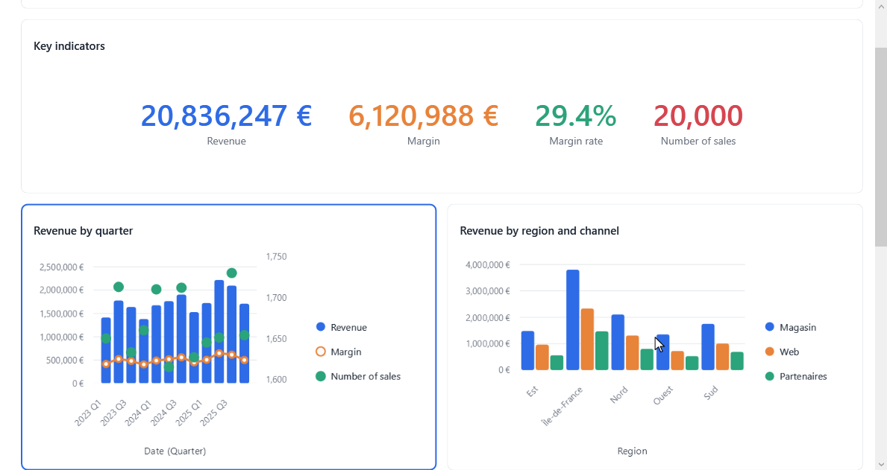
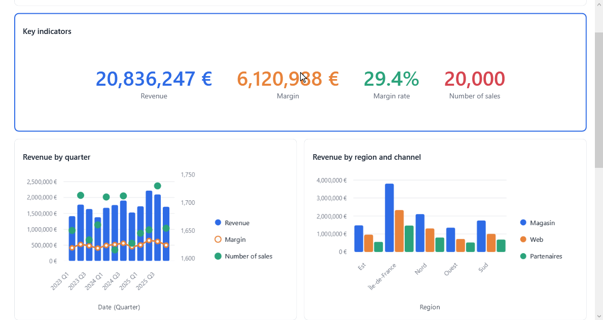

# What users do

Everything on this page works out of the box, and each interaction is a [behavior](customizing.md#behaviors) you can
configure, replace or remove. Every action is one undo step.

## Make visuals from fields

Drag a field from the field list onto the dashboard: next to an item, between two lines, or onto a free space. It
makes a visual; the other items make room live around a placeholder.

| Dropped | Gives |
|---|---|
| A measure, where an item can go | A KPI of that measure |
| A dimension, where an item can go | The first measure by that dimension: a line by month for a date, bars otherwise |
| Onto an empty item | Fills it |
| Onto a visual | Adds the field to it: a measure to its values, a dimension to its axis, then its legend; a dimension breaks a KPI down into bars |

??? info "Change what a field makes"
    The rules are pure functions in `FieldVisuals` (`Create`, `AddField`). Set `FieldDropBehavior.CreateVisual` and
    `AddField` to replace them.

## Add an item

- **"+"** on the right and bottom edges of an item adds an item next to it; "+" between lines and between bands adds a
  line or a band.
- A **free space** (room left by items of fixed size) shows a placeholder that adds an item there.
- An **empty item** offers a visual (opens the designer), a text, an image or a [variable](../guide/variables.md) to change.

## Move

Drag an item by its grip (⠿, top left on hover). Near an item's edge it goes next to it, between two lines it becomes a
line of its own, over a free space it fills it. The other items make room live; Escape cancels.

## Resize

Drag the handle in an item's bottom right corner. In a grid band, the item snaps to columns and rows; elsewhere, it
takes a width in pixels. Its neighbours share the rest; when they all have a fixed size, the room left becomes a free
space.

The toolbar's ↔ button gives a resized item its **automatic size** back.

## The item toolbar

On hover or selection, an item shows its toolbar:

| Item | Buttons |
|---|---|
| Any | ↔ automatic size (once resized), ✎ edit, ✕ remove |
| Text | Size, bold, alignment; double-click edits the text in place |
| Image | Fit: contain, cover, stretch |

✎ on a visual opens the [designer](../guide/designer/index.md) in a dialog.

## Select

| Action | Result |
|---|---|
| Click an item | Selects it |
| ++ctrl++ + click | Adds or removes it (on a chart's bar, slice or row, extends the [cross-filtering](../guide/cross-filtering.md) instead) |
| Drag from the background | Draws a selection box |
| Click the background, ++escape++ | Unselects |
| ++ctrl+a++ | Selects everything |

## Keyboard

| Keys | Action |
|---|---|
| Arrows | Select the nearest item in that direction (++shift++ adds it) |
| ++ctrl++ + arrows | Move the selected item: Left/Right swap it with its neighbour, Down/Up move it to the next line or band |
| ++ctrl+shift+down++ / ++ctrl+shift+up++ | Move it to a new band below / above |
| ++alt++ + arrows | Extend the selected items over the free room next to them |
| ++delete++ | Remove the selection |
| ++ctrl+d++ | Duplicate the selection |
| ++ctrl+c++, ++ctrl+x++, ++ctrl+v++ | Copy, cut, paste |
| ++ctrl+z++, ++ctrl+y++ | Undo, redo |

## Copy and paste

Copied items keep their arrangement and sizes, and paste after the line of the last selected item, also into another
dashboard. They take along the calculated measures they use; a measure whose name is taken by another definition is
renamed. Visuals of a model the target does not know are left out.

??? info "The clipboard"
    The clipboard holds an `easybi/v1` report with the visuals and their calculated measures
    (`VisualTransfer.ClipboardFormat`), their titles as text, and their layout (`DashboardView.LayoutClipboardFormat`).
    `CreateCopy` and `Paste(data)` work without the clipboard.

## Bands

The ⋮ menu on the left of a band changes its mode (Fit, Scroll, Wrap: see [Layout](layout.md#bands)), inserts a band
or removes it. ++shift++ + wheel, or the scroll bar, scrolls a Scroll band.
