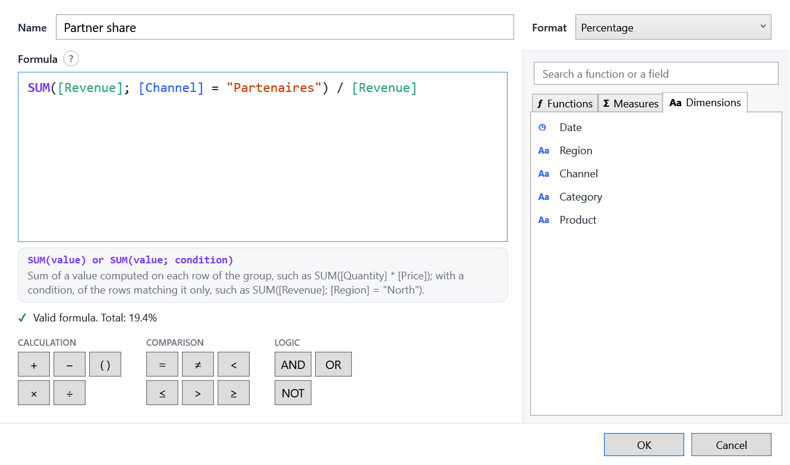

# Calculated measures

Ratios, shares, conditional sums: measures computed from the rows of each group, inside the same query. You declare
some in the model; your users write their own in a formula editor.



## Why not just a measure?

A ratio cannot be summed: the margin rate of a region is its **total margin divided by its total revenue**, not the
average of its sales' rates. A calculated measure is computed per group, in the query (in SQL with EF Core), so it can
be sorted, limited to a Top N and filtered like the others. Users cannot change its aggregation.

## Declared by you

| Method | For |
|---|---|
| `Ratio` | A sum divided by a sum; empty when the denominator sums to zero |
| `Calculated` | Any aggregate expression over the rows of the group |
| `Formula` | A formula, as users write them: they can read and rewrite it |

```csharp
model
    .Ratio(s => s.Margin, s => s.Amount, "Margin rate", "MarginRate", format: "P1")      // Σ margin / Σ revenue
    .Ratio(s => s.Amount, s => 1, "Average basket", "AverageBasket", format: "#,##0 €")   // Σ revenue / number of sales
    .Calculated(g => g.Sum(s => s.Amount) - g.Sum(s => s.Cost), "Gross profit", "GrossProfit")
    .Formula("SUM([Amount]; [Channel] = \"Web\") / [Amount]", "Web share", "WebShare", format: "P1");
```

!!! warning "Guard your divisions"
    With `Calculated`, guard divisions yourself: some databases fail on a division by zero. `Ratio` and formulas do it
    for you. A `Formula` may only use fields declared before it; an invalid one throws an `ArgumentException`.

## Created by your users

In the field list, **+ Calculated measure** opens the editor; ✎ and ✕ on a measure's hover edit and delete it. Users give
a name, a format and a formula over the model's fields, written with their captions.

The editor helps them as they type:

- the formula is colored, and its problem underlined and explained;
- the help of the function the caret is in shows above it;
- suggestions only offer what can be written there: after `SUM(`, measures and number dimensions; in a condition,
  dimensions; after `[Region] =`, the values of Region; after a condition, `AND` and `OR`;
- operators come as a keypad, functions, measures and dimensions in tabs to search and insert;
- the measure's total previews as it is typed.

## The formula language

| Formula | Computes |
|---|---|
| `[Margin] / [Revenue]` | The margin rate of each group |
| `SUM([Quantity] * [Unit price])` | A sum of a product, row by row |
| `SUM([Revenue]; [Region] = "North") / [Revenue]` | The share of the North |
| `COUNT([Channel] = "Web" AND [Date] >= "2024-01-01")` | The rows matching a condition |
| `DISTINCTCOUNT([Customer])` | The number of distinct customers |
| `IF([Revenue] > 1000; [Margin]; 0)` | A value by condition |
| `[Revenue] * (1 + [@Rate])` | With the value of a [parameter](variables.md) the dashboard changes |

### Functions

| Function | |
|---|---|
| `SUM`, `AVERAGE` (or `AVG`), `MIN`, `MAX` | Aggregate an expression read row by row. An optional last argument keeps the rows matching a condition. |
| `COUNT()`, `COUNT(condition)` | The rows, or those matching the condition. |
| `DISTINCTCOUNT(field)` | The distinct non-empty values. |
| `IF(condition; then; else)` | On the group or on each row; without `else`, empty. |

A measure on its own (`[Revenue]`) is aggregated as in the field list. `MeasureFormula.Functions` lists the functions
with their usage and description, in the user's language.

### Syntax

- Operators: `+ - * /` and parentheses. A division by zero gives an empty value.
- Comparisons: `= <> < <= > >=` (texts and yes/no values with `=` and `<>` only), combined with `AND`, `OR`, `NOT`;
  `TRUE` and `FALSE`.
- Numbers take a decimal point; texts and dates go in double quotes: `"North"`, `"2024-12-31"`.
- Arguments are separated by `;` or `,`.
- A dimension is only used inside a function; a measure calculated by the model (`Ratio`, `Calculated`) only outside.

In SQL, formulas become `CASE WHEN`, `COUNT(DISTINCT ...)`... in the same query as the other measures.

## Measures using measures

A formula can use the report's other calculated measures: with `[Cost] = [Revenue] - [Margin]`, the cost rate is
`[Cost] / [Revenue]`. They are computed per group, so they are used on their own, not inside a function.

- A measure cannot use itself, even through others: *A measure cannot use itself: this measure → [Cost] → this measure*.
  This is checked as it is typed and when a report is opened.
- Deleting a measure names the measures that use it.
- A copied visual takes the measures it uses along; pasted formulas follow the measures that are renamed.

## Redefining a model's measure

Users can also change the measures you declared (✎ on any measure). Their version is saved in the report under **the
same name**, and redefines the measure for the whole report:

- a formula that is only the measure itself (`[Revenue]`) keeps your computation, and only changes its caption and
  format;
- any other formula replaces the computation: `AVERAGE([Revenue])` changes the aggregation, the measure's name in it
  still meaning your definition.

↺ in the field list, or **Restore** in the editor, removes the redefinition.

## Where they are saved

Calculated measures live in `EasyBIContext.Measures`, one per open report: every field list, designer and visual of the
context sees them.

=== "With a dashboard"

    The `DashboardView` loads and saves them with its document. Undo does not remove them.

=== "Without a dashboard"

    ```csharp
    report = report with { Measures = context.Measures.Measures.ToArray() };   // save
    context.Measures.Load(report.Measures);                                     // open
    ```

??? info "Your own formula editor"
    `FormulaEditing` (`Tokenize`, `Calls`, `CallAt`, `CompletionAt`, `ContextAt`) and `MeasureFormula.Check` (the problem
    and where it is written) give the same help as EasyBI's editor. `CalculatedMeasureEditor` exposes it as a
    view-model: `Tabs`, `Search`, `OperatorGroups`, `Suggest`, `Accept`, `Insert`, `CurrentCall`, `Problem`.
    `MeasureContext` gives `MeasuresOf`, `GetField`, `Definition`, `Needed`, `UsedBy`, `Using`; `MeasureFormula`
    `Validate`, `Check`, `ToDisplay` and `Rename`.
