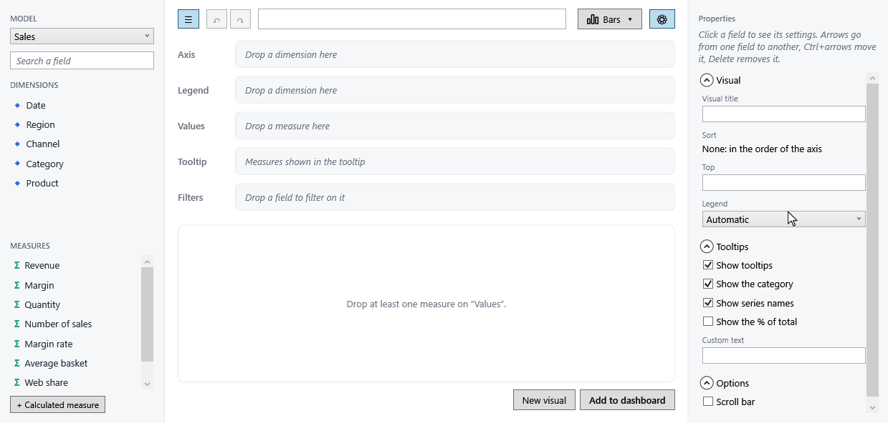
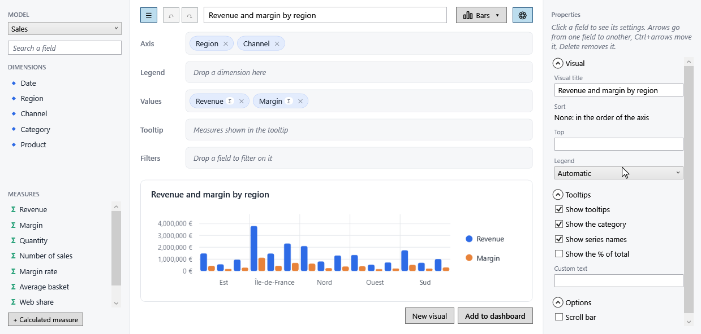

# Building a visual

What the end user does in the designer, step by step. Everything here works out of the box: this page is also a base for
your application's user help.

## Add fields

Drag a field from the list onto a well, or **double-click** it: a dimension goes to the axis, a measure to the values.

While a field is dragged, the wells tell whether they take it. Below, `Channel` (a dimension) is dragged over a bar
chart: the axis, the legend and the filters take it, the values do not.

A well that refuses a field says why, in the end user's language:

| Refusal | When |
|---|---|
| *Only measures go in Values* | A dimension dropped on the values. |
| *Only dimensions go in Axis* | A measure dropped on the axis or the legend. |
| *Region is already in Axis* | The field is already there. |
| *Category holds a single field* | The type allows one field there (a pie's category). |
| *Axis is not used by this type of visual* | A KPI has no axis, for instance. |
| *Region belongs to the model "Sales": choose this model first* | The field is from another model. |

## Pick a visual type

The type button opens a gallery grouped by use. A type that the active renderer cannot draw is greyed.

{ width="380" }
{ width="380" }

The **wells follow the type**: their names and limits change, and the wells a type does not use disappear.

| Type | Wells |
|---|---|
| Bars, stacked bars, points, lines, areas | Axis (up to 3 fields), Legend, Values, Tooltip, Filters |
| Pie, donut | Category (1), Value (1), Tooltip, Filters |
| Waterfall | Axis (1 to 3), Value (1), Tooltip, Filters |
| KPI | Values, Filters |
| Gauge | Value (1), Filters |
| Table | Rows (up to 3), Values, Filters |
| Matrix | Rows (up to 4), Columns (1), Values, Filters |

!!! note "Nothing is lost when the type changes"
    A well the new type does not use keeps its fields and stays shown, marked *Not used by this type of visual*, until
    the end user removes them or picks a type that uses them again.

## Arrange the chips

A field in a well is a **chip**. Its badges sum its settings up: `Σ` or `avg` (aggregation), `Quarter` (grain), `PY`
(time comparison), `Y2` (secondary axis), `↓` (sort).

- **Move** a chip by dragging it, within its well (the order of the axis or of the series) or to another well.
- **Remove** it with its `×`, or with ++delete++ once selected.
- **Select** it with a click: the properties panel shows its settings.

## Set the details

The properties panel shows the settings of the selected chip, in sections:

{ width="300" }
{ width="300" }

| Selection | Sections |
|---|---|
| A measure | Aggregation, [time comparison](../../visuals/time-comparisons.md), [chart type and secondary axis](../../visuals/combined-charts.md), sort, [formatting](../../visuals/conditional-formatting.md) |
| A dimension | Grain (dates), sort, [value labels](../../visuals/value-labels.md) |
| A filter | Its values, or a period for a date |
| Nothing (Escape) | Title, sort, Top N, [legend](../../visuals/legends.md), [tooltips](../../visuals/tooltips.md), the renderer's options |

## Undo, redo, keyboard

Every change of the visual can be undone: **Ctrl+Z**, **Ctrl+Y** (or Ctrl+Shift+Z), or the header's arrows. The history
keeps 100 steps and starts over when another visual is loaded.

Once a chip is selected, the keyboard drives the wells:

| Keys | Action |
|---|---|
| ++left++ / ++right++ | Previous / next chip |
| ++up++ / ++down++ | Chip of the well above / below |
| ++ctrl+left++ / ++ctrl+right++ | Move the selected chip within its well |
| ++delete++ | Remove the selected chip |
| ++escape++ | Select the visual (its settings show) |

Text boxes and lists keep their own keys: typing a title never moves a chip.
