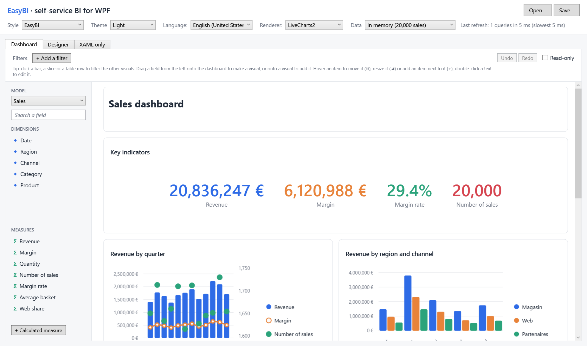
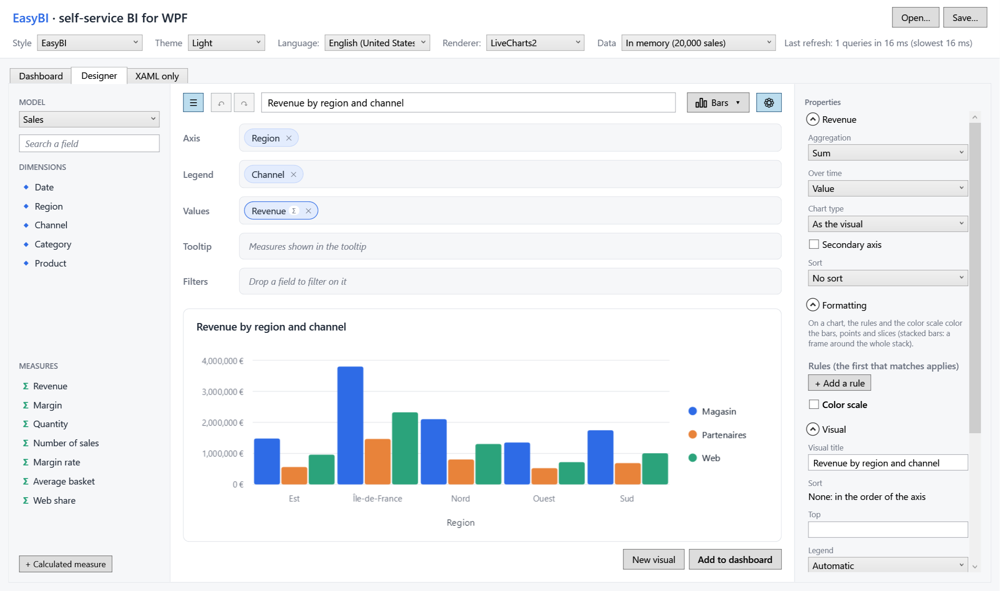
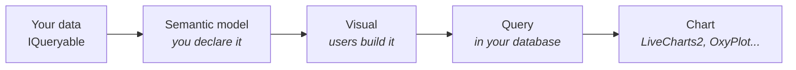

---
hide:
  - navigation
---

# EasyBI

**Self-service BI for WPF.** You declare what can be analyzed; your users build their charts, tables and dashboards by
drag and drop, inside your application.



[Get started](getting-started.md){ .md-button .md-button--primary } [See the sample](https://github.com/TheoCvg/EasyBI/tree/develop/samples/EasyBI.Sample){ .md-button }

## In three steps

=== "1. Describe your data"

    ```csharp
    var model = SemanticModel.For(sales, "sales", "Sales")
        .Dimension(s => s.Date, "Date")
        .Dimension(s => s.Region, "Region")
        .Measure(s => s.Amount, "Revenue", format: "#,##0 €");
    ```

=== "2. Create the context"

    ```csharp
    Context = EasyBIContext.Create()
        .AddModel(model)
        .UseRenderer(new LiveCharts2Renderer());
    ```

=== "3. Show the designer"

    ```xml
    <bi:ReportDesigner Context="{Binding Context}" Visual="{Binding Visual}" />
    ```

## What your users get

<div class="grid cards" markdown>

-   **A designer**

    ---

    

    Fields dragged onto wells, a dozen types of visuals, a properties panel, undo and redo.

    [:octicons-arrow-right-24: The designer](guide/designer/index.md)

-   **Dashboards**

    ---

    

    Visuals arranged and resized by drag and drop, filled by dragging fields, with global filters and cross-filtering.

    [:octicons-arrow-right-24: Dashboard](dashboard/index.md)

-   **Their own measures**

    ---

    

    Formulas such as `SUM([Revenue]; [Region] = "North") / [Revenue]`, with an editor that suggests what can be written.

    [:octicons-arrow-right-24: Calculated measures](guide/calculated-measures.md)

-   **Your look**

    ---

    

    Light and dark, following WPF UI or Material Design. English and French, switched at runtime.

    [:octicons-arrow-right-24: Theming](customization/theming.md)

</div>

## Built for developers

- **One query per visual, in your database.** Filters, grouping, aggregates, sort and Top N stay in the `IQueryable`:
  with EF Core, one SQL statement per visual, whatever the size of the table.
- **Plain records and JSON.** Visuals and reports are immutable records, saved in a documented, versioned format
  (`easybi/v1`).
- **Open everywhere.** Lookless controls made of [slots](customization/slots.md), [rules](guide/designer/rules.md) on
  what users may change, your own [chart connector](customization/connectors.md) and [visual
  types](customization/visual-types.md).

## How it works



| Package | Role |
|---|---|
| `EasyBI.Wpf` | The controls: designer, visual, dashboard, filter bar, field list. Brings `EasyBI.Core` (query engine, JSON) and `EasyBI.Abstractions` (the records). |
| `EasyBI.Renderers.LiveCharts2` | Draws the charts with LiveCharts2. |
| `EasyBI.Renderers.OxyPlot` | Draws the same charts with OxyPlot. |
| `EasyBI.Themes.WpfUi` | Follows a WPF UI theme. |
| `EasyBI.Themes.MaterialDesign` | Follows a Material Design in XAML theme. |

!!! note "Versions"
    This site documents every published version: pick one in the selector at the top of the page. **dev** is the
    development branch, not yet released.
